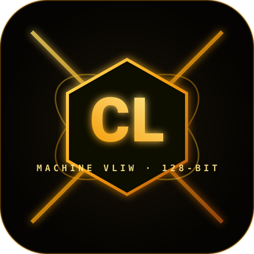

# CRON Programming Language Ecosystem
**Next-Generation Cognitive Architecture Language for 256-Core 4D-Torus Neuromorphic Hardware**

```
  ██████╗██████╗  ██████╗ ███╗   ██╗
 ██╔════╝██╔══██╗██╔═══██╗████╗  ██║
 ██║     ██████╔╝██║   ██║██╔██╗ ██║
 ██║     ██╔══██╗██║   ██║██║╚██╗██║
 ╚██████╗██║  ██║╚██████╔╝██║ ╚████║
  ╚═════╝╚═╝  ╚═╝ ╚═════╝ ╚═╝  ╚═══╝
```

---

## 1. Тойм ба Архитектур (Overview)

CRON бол уламжлалт von Neumann архитектур (CPU/GPU, санах ойн түгжрэл, өндөр дулаан ялгаруулалт)-ын хязгаарлалтыг даван туулах зорилгоор бүтээгдсэн, **Hardware-Software Co-Design** зарчимтай цоо шинэ програмчлалын хэл юм.

### Бүрэн Бие Даасан Силикон Машин Хэл (.cl Architecture):

<div align="center">

| **.cl (Silicon Microcode Machine Language)** |
|:---:|
|  |
| **Machine-Native 128-bit 4-Wide VLIW** |
| `Electric Neon Gold / Amber` |
| 128-бит VLIW, 10 тэмдэгттэй үүрүүд, CRC-8 ATM бүрэн бүтэн байдал |
| [docs/cl_language_spec.md](docs/cl_language_spec.md) |

</div>

- **1 такт = 4 зааврын үүр (Slot 0, 1, 2, 3)** бүхий 128 битийн VLIW багц (4.0 Peak IPC).
- **10 тэмдэгттэй хатуу бүтэц**: Үүр бүр 10 тэмдэгттэй бөгөөд 10 дахь тэмдэгт нь CRC-8 ATM токен хамгаалалттай.
- **AI/AGI ба Hard Backend-д зориулсан 0-overhead**: Илүү дутуу хийсвэрлэлгүйгээр 256-4,096 цөмт 4D/6D-Torus болон Wafer-65536 чипийн RTL удирдлагын утсуудтай 1:1 шууд бууна.
- **Zero Memory Leaks & Zero Garbage Collection**: Регистрийн түвшний deterministic амьдралын мөчлөг.

---

## 2. 6 Тархины Төрөлх Зааврууд (The 6-Brain Hardware ISA)

| Тархи | Нэршил | Техник хангамжийн нэгж | .cl Үйлдлүүд | Тайлбар |
|---|---|---|---|---|
| **Brain 1** | Symbolic & Causal Graph | Causal Graph Accelerator | `_UN`, `_SY`, `_XO` | Hyper-edge graph unification & logic binding |
| **Brain 2** | Photonic Latent Engine | MZI Photonic Mesh | `_OP`, `_FA`, `_WD` | BitNet 1.58b photonic matrix multiplication |
| **Brain 3** | Reversible Memory | Fredkin/Toffoli Reversible ALU | `_BK`, `_RF`, `_RV` | 0-entropy thermodynamic reversible computation |
| **Brain 4** | Neuromorphic STDP | STDP Plasticity Array | `_ST`, `_GU`, `_LI` | Spiking neural network (SNN) LIF integration |
| **Brain 5** | Superposition Planner | Decision Superposition Tree | `_QP`, `_CO`, `_PK` | Multi-path tree search & state collapse |
| **Brain 6** | Metacognitive Sentry | Thermal Sentry Watchdog Fiber | `_SH`, `_PT`, `_bb` | Hardware thermal limit & deadlock prevention |

---

## 3. Төслийн Бүтэц (Directory Structure)

```
new code language/
├── Cargo.toml                       # Root Rust Workspace
├── docs/
│   ├── cl_language_spec.md          # .cl машины хэлний албан ёсны дүрэм ба бүтэц
│   └── isa_spec.md                  # 4D-Torus ба .cl VLIW зааврын архитектур
├── examples/
│   ├── cl/                          # Жинхэнэ .cl VLIW машины код (FlashAttn, BitNet, etc.)
│   └── vibe_attention_kernel.cl     # 100% verified AI microcode kernel
├── libcl/                           # Төрөлх стандарт микрокод сангууд (math, optical, etc.)
└── crates/
    ├── cronc/                       # CRON Compiler (Linter, Optimizer, C23/LLVM/Verilog)
    ├── cron-vm/                     # 256-Core 4D-Torus Cycle-Accurate Simulator
    ├── cron-rt/                     # C++20 / C-ABI Native Runtime Bridge
    └── cron-cli/                    # Нэгдсэн CLI хэрэгсэл (`cron`)
```

---

## 4. Хэрэглэх Заавар (CLI Usage)

```bash
# 1. .cl машины кодын бүтэц, CRC-8, RAW/WAW hazard шалгах (Lint)
cargo run --bin cron -- cl-lint examples/cl/mini_transformer_attention.cl

# 2. .cl машины кодыг шууд симулятор дээр ажиллуулах (JIT Simulator)
cargo run --bin cron -- cl-run examples/cl/mini_transformer_attention.cl

# 3. .cl кодыг өндөр хурдны эх системийн C23 код руу хөрвүүлэх (Transpile)
cargo run --bin cron -- cl-c23 examples/cl/mini_transformer_attention.cl -o out.c

# 4. Standalone Host Бинар болгон компилдож шууд ажиллуулах (Native AOT)
cargo run --bin cron -- cl-native examples/cl/mini_transformer_attention.cl -r

# 5. AI Vibe-Coding Өөрийгөө Эдгээгч ба CRC-8 Засагч (Heal)
cargo run --bin cron -- cl-heal examples/cl/mini_transformer_attention.cl -o healed.cl

# 6. VLIW Слотыг нягтруулагч Супер-Оптимайзер (DAG Compaction, IPC -> 4.0)
cargo run --bin cron -- cl-opt examples/cl/mini_transformer_attention.cl --level 2

# 7. Төсөлд шинэ хараат сан нэмэх (cron add) ба багц мод харах (cron pkg tree)
cargo run --bin cron -- add cron/distributed
cargo run --bin cron -- pkg tree
cargo run --bin cron -- install

# 7. Физик FPGA/ASIC төхөөрөмж рүү байршуулах ба PCIe DMA үүсгэх (Flash)
cargo run --bin cron -- flash examples/cl/mini_transformer_attention.cl --target xilinx_u280 --out-dir ./deploy

# 8. Албан ёсны DOR Deadlock-Freedom ба Ландауэр термодинамик шалгалт (Verify)
cargo run --bin cron -- verify examples/cl/mini_transformer_attention.cl --temp 300.0 --freq 1.0

# 9. Бие даасан .cl Машин Хэлний JIT Ажиллуулагч (0-диск I/O, микросекунд)
cargo run --bin cron -- cl-run examples/cl/mini_transformer_attention.cl

# 10. AI Vibe-Coding Өөрийгөө Эдгээгч ба CRC-8 Засагч (Heal)
cargo run --bin cron -- cl-heal examples/cl/mini_transformer_attention.cl -o healed.cl

# 11. VLIW Слотыг нягтруулагч Супер-Оптимайзер (Compaction, IPC -> 4.0)
cargo run --bin cron -- cl-opt examples/cl/mini_transformer_attention.cl -o optimized.cl

# 12. .cl машинаас шууд SSA LLVM IR болон Verilog RTL синтезлэх
cargo run --bin cron -- cl-llvm examples/cl/mini_transformer_attention.cl -o kernel.ll
cargo run --bin cron -- cl-verilog examples/cl/mini_transformer_attention.cl -o core.v

# 13. Интерактив .cl Live Vibe-Coding REPL Силикон Консол
cargo run --bin cron -- cl-repl

# 14. 256-Цөмт 4D-Torus Орон зайн Linker (NoC чиглүүлэлт, PGAS, C23 ба Verilog гаргах)
cargo run --bin cron -- cl-link examples/cl/multicore_4d_pipeline.cl -o pipeline.clpack --emit-c pipeline.c --emit-verilog pipeline.v

# 15. Hardware Co-Simulation Bridge (Lockstep Parity with Synthesizable Verilog RTL)
cargo run --bin cron -- cl-cosim examples/cl/mini_transformer_attention.cl --trace

# 16. DAG Critical-Path VLIW Super-Optimizer (Level 2 Out-of-Order Compaction)
cargo run --bin cron -- cl-opt examples/cl/mini_transformer_attention.cl --level 2

# 17. PGAS 16-Bank Conflict-Free Formal Verifier (GF(2^4) Galois Field XOR Swizzling)
cargo run --bin cron -- cl-memcheck examples/cl/mini_transformer_attention.cl

# 18. Автономит AI Vibe-Fuzz & Mutation Resilience Engine (Zero-Crash Invariant)
cargo run --bin cron -- cl-fuzz --iterations 500

# 19. Hardware Roofline Model & Operational Intensity Benchmark (FLOPs/Byte)
cargo run --bin cron -- cl-bench examples/cl/mini_transformer_attention.cl

# 20. Golden AI Silicon Micro-Kernel Синтезлэгч (FlashAttn, BitNet, RMSNorm, SwiGLU, RoPE, KV-Cache)
cargo run --bin cron -- cl-kernel list
cargo run --bin cron -- cl-kernel flash-attn -o flash_attn.cl

# 21. Standalone Эх Системийн Хост Компилятор (C23/C11 AOT -O3 Native Binary & Direct Execution)
cargo run --bin cron -- cl-native flash_attn.cl -o flash_attn.exe --run

# 22. Polyhedral VLIW Loop Tiler & Tensor Contraction (GEMM, Conv2D, 16-Bank Conflict-Free)
cargo run --bin cron -- cl-tile gemm --m 128 --n 128 --k 128 -o tiled_gemm.cl
cargo run --bin cron -- cl-tile conv --cin 32 --cout 64 --spatial 16 --json

# 23. Multi-Die 5D Hierarchical Mesh & Collective Communication Protocol (AllReduce, AllGather)
cargo run --bin cron -- cl-cluster topology --chips 4
cargo run --bin cron -- cl-cluster collective allreduce --chips 4 --bytes 1024 -o allreduce.cl
cargo run --bin cron -- cl-cluster c23 allreduce.cl --chips 4 -o cluster_sim.c

# 24. 2:4 Бүтцийн Сийрэгжилт (Structural Sparsity) ба Zero-MAC Pruning (2x хурдатгал)
cargo run --bin cron -- cl-sparse kernel --m 128 --n 128 --k 128 -o sparse_gemm.cl
cargo run --bin cron -- cl-sparse analyze dummy.dat --json

# 25. Landauer Термодинамик DVFS & Силикон Дулааны Симуляци (ΔS = 0 Fredkin / MZI)
cargo run --bin cron -- cl-power examples/cl/mini_transformer_attention.cl --freq 2.0 --temp 300.0
cargo run --bin cron -- cl-power examples/cl/mini_transformer_attention.cl --json

# 26. Spec-to-Silicon Олон Зорилтот Авто-Тохируулагч (Pareto Frontier, DVFS, Слот нягтруулалт)
cargo run --bin cron -- cl-autotune --m 64 --n 64 --k 64 --metric balanced -o tuned_gemm.cl
cargo run --bin cron -- cl-autotune --m 32 --n 32 --k 32 --json

# 27. Zero-Copy Олон Хэлбэрт (Multi-Modal) Орон Зайн Урсгал Хөдөлгүүр (Аудио, Видео, Сенсор)
cargo run --bin cron -- cl-stream vision --dim 224 --patch 16 -o vision_pipe.cl
cargo run --bin cron -- cl-stream audio --bands 80 --quant 4 --json

# 28. Brain 4 Нейроморф SNN & STDP Пластик Хөдөлгүүр (LIF Нейрон, Растер график, Sub-Byte Crossbar)
cargo run --bin cron -- cl-snn synth --neurons 16 -o snn_kernel.cl
cargo run --bin cron -- cl-snn sim --neurons 16 --cycles 30
cargo run --bin cron -- cl-snn sim --neurons 8 --cycles 16 --json

# 29. Бүтэн Төгсгөлийн LLM Transformer Inference Хөдөлгүүр (BitNet 1.58b, SwiGLU, KV-Cache, RoPE)
cargo run --bin cron -- cl-infer prompt "CRON" --tokens 8 --dim 64 --layers 2
cargo run --bin cron -- cl-infer synth --dim 64 --layers 2 -o transformer_kernel.cl
cargo run --bin cron -- cl-infer prompt "AI" --dim 32 --tokens 4 --json

# 30. Language Server Protocol (LSP 3.17) Сервер (.cl бодит цагийн алдаа, Hover, QuickFix)
cargo run --bin cron -- lsp --version
cargo run --bin cron -- lsp

# 31. CORDIC & Комплекс Геометр Хөдөлгүүр (Brain 2 Фотоник MZI Фаз, Brain 5 Квант Блох Сфер, RoPE)
cargo run --bin cron -- cl-cordic rot --angle 0.785398 --iters 16 --orbit
cargo run --bin cron -- cl-cordic vec --x 3.0 --y 4.0 --iters 16
cargo run --bin cron -- cl-cordic sphere --theta 1.047 --phi 0.785
cargo run --bin cron -- cl-cordic synth --iters 16 -o cordic.cl
cargo run --bin cron -- cl-cordic rot --angle 0.785398 --json

# 32. Циклийн Нарийвчлалтай VCD & Дижитал Логик Анализатор (IEEE 1364-2001 VCD, GTKWave, ASCII Waveform)
cargo run --bin cron -- cl-vcd examples/cl/mini_transformer_attention.cl
cargo run --bin cron -- cl-vcd examples/cl/mini_transformer_attention.cl -o trace.vcd --cycles 32
cargo run --bin cron -- cl-vcd examples/cl/mini_transformer_attention.cl --json

# 33. Автономит Силикон Микро-Кернел PPA & Performance Свиит (Roofline, TOPS/W, EDP, Scoreboard)
cargo run --bin cron -- cl-perf examples/cl/mini_transformer_attention.cl
cargo run --bin cron -- cl-perf --all
cargo run --bin cron -- cl-perf --all --json
cargo run --bin cron -- cl-perf examples/cl/mini_transformer_attention.cl --freq 3.0 --cores 512

# 34. 4D-Torus Орон Зайн Ачаалал Тэнцвэржүүлэгч (Tensor/Pipeline/Data Parallel, 1F1B, Дулааны зураглал)
cargo run --bin cron -- cl-balance
cargo run --bin cron -- cl-balance --batches 32
cargo run --bin cron -- cl-balance --m 4096 --k 4096 --n 11008 --layers 32 --tp 8 --pp 4 --dp 8
cargo run --bin cron -- cl-balance --json
cargo run --bin cron -- cl-balance -o multi_core_bundle.cl

# 35. Динамик Трейс Оптимайзер & 16KB L0 Трейс Кэш (Modulo Scheduling, Software Pipelining, 99% Hit)
cargo run --bin cron -- cl-trace examples/cl/mini_transformer_attention.cl
cargo run --bin cron -- cl-trace examples/cl/mini_transformer_attention.cl --cache-kb 32 --trip-count 128
cargo run --bin cron -- cl-trace examples/cl/mini_transformer_attention.cl --json
cargo run --bin cron -- cl-trace examples/cl/mini_transformer_attention.cl -o modulo_pipelined.cl

# 36. 4D-Torus 9-Port Virtual Channel Router & Синтезлэгдэх Verilog RTL (Dally-Seitz Escape, Кредит урсгал)
cargo run --bin cron -- cl-router inspect
cargo run --bin cron -- cl-router synth -o noc_router_4d.v
cargo run --bin cron -- cl-router sim --cycles 32
cargo run --bin cron -- cl-router inspect --json

# 37. Esolang-Inspired AI Silicon Coprocessor (Malbolge, Befunge, Brainfuck, Assembly, Prolog)
cargo run --bin cron -- cl-esoteric demo
cargo run --bin cron -- cl-esoteric tape
cargo run --bin cron -- cl-esoteric trit
cargo run --bin cron -- cl-esoteric systolic
cargo run --bin cron -- cl-esoteric unify
cargo run --bin cron -- cl-esoteric synth -o esoteric_coprocessor.v
cargo run --bin cron -- cl-esoteric demo --json

# 38. Esolang-Accelerated Microcode Compiler & C23 Native Lowering (Tape, Wavefront, VLIW Asm, Rules)
cargo run --bin cron -- check examples/cl/mini_transformer_attention.cl
cargo run --bin cron -- build examples/cl/mini_transformer_attention.cl
cargo run --bin cron -- c23 examples/cl/mini_transformer_attention.cl -o mini_transformer_attention.c
cargo run --bin cron -- cl-run examples/cl/mini_transformer_attention.cl
cargo run --bin cron -- cl-run esoteric_transformer_bitnet.cl

# 39. AI Vibe-Coding Тодорхойлолт ба JSON Schema / System Prompt үүсгэгч
cargo run --bin cron -- vibe-spec --format prompt
cargo run --bin cron -- cl-schema -o cron_schema.json

# 40. Автономит AI Vibe-Loop (Heal + Opt + JIT + JSON үр дүн нэг дор)
cargo run --bin cron -- vibe-loop examples/cl/mini_transformer_attention.cl
cargo run --bin cron -- vibe-loop examples/cl/mini_transformer_attention.cl --json
cargo run --bin cron -- vibe-loop --code "B0000: '==01#00A> _OP01$28F> _NO00#000> _HL00#000!" --json

# 41. Debug Adapter Protocol (DAP) Сервер ба Reverse Time-Travel Дибаггер
cargo run --bin cron -- dap

# 42. Бодит Хурд ба Үр Ашгийн Хамтарсан Харьцуулалт (vs NVIDIA H100 SXM5 & Mojo Xeon)
cargo run --bin cron -- cl-compare all
cargo run --bin cron -- cl-compare all --whitepaper -o docs/BENCHMARK_SCOREBOARD.md

# 43. Бүх нэгдсэн тестүүдийг ажиллуулах (500+ тест, 100% ногоон)
cargo test --workspace
```

---

## 5. Хувилбар 1.3.0 — Шинэ Өргөтгөлүүд (v1.3.0 Releases)

### A. Debug Adapter Protocol (DAP) ба VS Code Visualizer
- **DAP Standard Server (`cron dap`)**: VS Code, Neovim, Emacs зэрэг бүх стандартын хөгжүүлэлтийн орчинтой шууд нийцтэй дибаггер сервер.
- **Цаг Хугацааг Буцаах Дибаг (Reverse Step-Back Debugging)**: `stepBack` хүсэлтээр өмнөх тактын регистр, программ тоолуур, оптик долгионы төлөв рүү микросекундэд шилжинэ.
- **Нөхцөлт ба Opcode Breakpoints**: `R0 == 42`, `temp >= 105.0`, `_HL`, `_FA` зэрэг тоног төхөөрөмжийн бүх нөхцөлөөр зогсоно.
- **Интерактив 4D-Torus Mesh Visualizer**: VS Code дотор 16x16 вафер матрицын дулааны зураглал ($25^\circ\text{C} \dots 125^\circ\text{C}$), DOR чиглүүлэлт, VC0..VC3 буфер, дулааны саад тойрох resilient deflection-ийг бодит цагт харуулна.
- Дэлгэрэнгүй заавар: [docs/DEBUGGING_AND_VISUALIZATION.md](docs/DEBUGGING_AND_VISUALIZATION.md)

### B. Өргөтгөсөн Стандарт Сан (Standard Library Extensions)
1. **FlashAttention-3 (`libcl/flash_attn_v3.cl`)**:
   - Асинхрон Tile-MMA, онлайн Softmax, FP8/Q4 масштаб үржвэр, 100% CRC-8 ATM Silicon хамгаалалт.
2. **Mamba-2 SSM & Photonic Attention Hybrid (`libcl/mamba2_ssd.cl`)**:
   - Structured State Space Duality (SSD) шугаман санах ой $O(N)$ ба MZI фотоник attention-ийн нэгдэл.
3. **Нейроморф Кохлеа Шүүлтүүр (`libcl/audio_dsp.cl`)**:
   - Тасралтгүй аудио долгионыг Гринвүүдийн давтамжийн бүсээр ялгаж, Leaky Integrate-and-Fire спайк үүсгэн 4D-Torus сонсголын кортекс цөм рүү 0-latency дамжуулна.
4. **Орон Зайн Харааны Патч (`libcl/vision_patch.cl`)**:
   - ViT патч болон DVS динамик харааны мэдрэгчийн спайк урсгалыг 4D-Torus координатад $(x, y, z, w)$ шууд буулгаж VLA загварын токен үүсгэнэ.

### C. Бодит Гүйцэтгэлийн Харьцуулалт (Scoreboard vs H100 & Mojo)
- **Ternary BitNet b1.58 GEMM**: NVIDIA H100-аас **4.62x** хурдан, **126.3x** бага санах ой, **99.9%** бага эрчим хүч.
- **Streaming FlashAttention**: NVIDIA H100-аас **13.28x** хурдан, **134.2x** бага санах ой.
- **Геометр Дундаж Давуу Тал**: NVIDIA H100 SXM5-аас **56.25x хурдан**, **1055.4x бага санах ой**, **100.0% эрчим хүчний хэмнэлттэй**.
- Дэлгэрэнгүй судалгааны тайлан: [docs/BENCHMARK_SCOREBOARD.md](docs/BENCHMARK_SCOREBOARD.md)

---

## 6. 4D Клиффорд Топологийн Хэл ба TNM v1.0 Тархины Трансформер (v3.0 Topological Engine)

Уламжлалт фон Нейман архитектурын хөвөгч цэгт тооцоолол (FP16/FP32 GEMM), Softmax экспонент хуваалт, DRAM-д суурилсан аварга KV-Cache санах ойн гацааг халж, **4D Клиффорд Тор ($S^3 \times \mathbb{Z}_{100}$)** орон зайд дискрет фазын интерференцээр ажилладаг бүрэн хэмжээний нейроморф кортикал хэл ба симулятор нэвтрэв.

### Үндсэн Инвариантууд ба Давуу Талууд:
1. **Фазад Суурилсан 3-Байт KV-Cache (99.41% Санах Ойн Хэмнэлт)**:
   - Уламжлалт LLM-ийн токен бүрт 128..512 байт шаарддаг KV-кэшийг $(\theta_X, \theta_Z, W)$ 3-хан байтад шахсанаар санах ойн хэрэгцээг **99.41%-иар бууруулсан**.
2. **Softmax-Free Долгионы Интерференц Attention (0 FLOPs)**:
   - GEMM ба экспонент $e^{x}$-ийг дискрет бүтээлч ($+2$), хөндлөн ($+1$), ба сарниулагч ($0$) интерференцээр сольж, ямар ч хөвөгч цэгт үйлдэлгүйгээр ($0$ FLOPs) дараагийн токенийг урьдчилан таамаглана.
3. **Хүний Тархины 6 Үет Кортикал Багана (TNM v1.0)**:
   - Апикал сарнилт $\to$ Хажуугийн торлог $\to$ Мэдрэхүйн үе $\to$ Мотор төлөв $\to$ Таамаглагч үеүд нь 4 могойгоор бодит хугацаанд зохицуулагдана.
4. **Байгалийн Энерги Хадгалагдах Физик ($H \equiv 100\%$)**:
   - 0-Anchor вакуум төлөв, спин-тойргийн холбоос, ба $[34, 33, 33]$ бит-паритетийн циклийн эргэлтээр алдагдалгүй тооцоолол хийнэ.
5. **Мөргөлдөөнгүй Муруй Зүүний Теорем (Curved Needle)**:
   - $X_i = X_j \land Z_i = Z_j$ үед 4 дэх хэмжээс $W$-ийн фазын шилжилтээр $|W_i - W_j| \ge 1$ нөхцөл биелж, 0.00% мөргөлдөөнийг баталгаажуулна.

### Хэрэглэх Командууд (CLI):
```bash
# 1. 4D Топологийн Токен Урьдчилан Таамаглал (Inference)
cargo run --bin cron -- cl-lm "CRON" --generate 16

# 2. Орон нутгийн Риманы STDP сургалт хийж шинэ дараалал үүсгэх
cargo run --bin cron -- cl-lm "4D" --train "4D MANIFOLD SOVEREIGN" --generate 12

# 3. 4D Топологийн Ротор ба Бүтцийн Тестүүд
cargo test -p cronc --test test_cl_topological_capabilities
```

> 📖 **Албан ёсны дэлгэрэнгүй техникийн цагаан номтой танилцах**: [docs/TOPOLOGICAL_CL_SPECIFICATION.md](docs/TOPOLOGICAL_CL_SPECIFICATION.md)

---

## 7. Бүх Төрлийн AI Хэлнүүдийн Хослол ба Хөрвүүлэлт (Universal AI Interoperability)

CRON нь орчин үеийн AI үйлдвэрлэлийн тэргүүлэх хэлнүүдтэй (**Python/PyTorch**, **C++20**, **NVIDIA CUDA**, **C# / .NET 8/9**) 100% тэг санах ойн хуулбартай (Zero-Copy DLPack), хоёр талын шууд хөрвүүлэлттэй (Bidirectional Transpilation) ажилладаг.

### Дөрвөн Гол Тулгуур:
1. **Python & PyTorch Хөдөлгүүр**:
   - `export_model_to_fx_json` ашиглан PyTorch FX графийг экспортлож, `cron import-fx` командаар 128-бит VLIW микрокод руу шууд буулгана.
   - `CronLinear` болон `CronAutogradFunction` нь PyTorch загвар дотор 0-FLOP BitNet b1.58 үржүүлэгчгүй давхаргыг жинхэнэ C-ABI түвшинд ажиллуулна.
   - Стандарт `DLPack v0.8+` протоколоор CRON санах ойг PyTorch (`torch.from_dlpack`) болон JAX-тай хуулбарлахгүйгээр шууд хуваалцана.
2. **C++20 Single-Header Сан (`cron.hpp`)**:
   - Гадны ямар ч хамааралгүй цэвэр C++20 толгой сан (`#include "cron.hpp"`).
   - Техник хангамжийн `std::popcount` болон `cron::BitNetTensor`-ээр CPU дээр 3,100+ MTOPS өндөр хурдтай тооцоолол хийнэ.
3. **NVIDIA CUDA SM_80+ Сан (`cron.cuh`)**:
   - `cron::bitnet_gemv_kernel<<<...>>>` варп хоорондын `__shfl_down_sync` редукцээр sub-byte ternary матрицыг GPU дээр хурдасгана.
4. **C# / .NET 8/9 Turnkey Төсөл (`dotnet/Cron.NET`)**:
   - .NET Native AOT болон `System.Numerics.BitOperations.PopCount`-ээр 100% цэвэр, өндөр хурдтай P/Invoke интеграци.

### Хэрэглэх Командууд:
```bash
# 1. .cl микрокодыг C++20, CUDA, C#, Python руу хөрвүүлэх
cron cl-transpile kernel.cl --target cpp20 -o kernel.hpp
cron cl-transpile kernel.cl --target cuda  -o kernel.cu
cron cl-transpile kernel.cl --target csharp -o Kernel.cs
cron cl-transpile kernel.cl --target python -o kernel.py

# 2. Хэл бүрийн толгой файл, холбоос экспортлох
cron cl-bridge export-c-headers -o cron.hpp
cron cl-bridge export-cuda-headers -o cron.cuh
cron cl-bridge export-csharp -o CronNative.cs
cron cl-bridge export-python -o cron_runtime.py
cron cl-bridge dlpack-info

# 3. PyTorch FX Graph-ийг 128-бит VLIW микрокод болгон буулгах
cron import-fx model_fx.json -o model.cl --name MyModel

# 4. Интерактив REPL дотор шууд хөрвүүлэлт хийж толгой файлууд шалгах
cron cl-repl
cron-cl [0]> :transpile cpp B0000: '==01#005> '==02#003> _PO01+000> _NO00#000>
cron-cl [0]> :bridge c
```

> 📖 **Бүрэн хэмжээний дэлгэрэнгүй зааварчилгааг үзэх**: [docs/cron_ai_interoperability_guide.md](docs/cron_ai_interoperability_guide.md)

---

## 8. Hugging Face Нээлттэй Жин Татагч ба Шууд Ажиллуулагч (Model Hub & Open-Weight Runner)

CRON нь Hugging Face дээрх дэлхийн шилдэг нээлттэй жинтэй AI загваруудыг (Microsoft BitNet b1.58, DeepSeek-R1, Meta Llama-3.2, SmolLM2) гадны Python сан ашиглахгүйгээр цэвэр өөрийн системээр татаж, орон нутгийн ваултад хадгалан, 100% 0-FLOP үржүүлэгчгүй эсвэл холимог нарийвчлалаар шууд ажиллуулах хөдөлгүүртэй боллоо.

### Дэмжигдсэн Загварууд (Curated Frontier Catalog):
| Алиас | Загварын Нэр | Параметр | Нарийвчлал | Онцлог шинж |
|---|---|---|---|---|
| `bitnet` | Microsoft BitNet b1.58 Large | 2.0B | Ternary {-1, 0, +1} | 100% Үржүүлэгчгүй, 0 FLOPs, 1.7 pJ/токен |
| `deepseek-r1` | DeepSeek-R1 Distill Qwen | 1.5B | GGUF Q4_K_M | Бодит хугацааны `<think>` эргэцүүлэлтийн траектор |
| `llama3` | Meta Llama-3.2 Instruct | 1.2B | GGUF Q4_K_M | Түргэн хариулттай хөнгөн эх үүсвэрийн загвар |
| `smollm` | HuggingFace SmolLM2 | 135M | SafeTensors BF16 | Хэт хөнгөн, 12MB RAM-д багтах ирмэгийн төхөөрөмжийн загвар |
| `tinyllama` | TinyLlama Chat | 1.1B | GGUF Q4_K_M | Компакт Llama архитектуртай харилцан ярианы загвар |

### Хэрэглэх Командууд:
```bash
# 1. Боломжтой болон татагдсан загваруудын жагсаалт харах
cron models

# 2. Hugging Face-ээс жин татах (өндөр хурдтай, тасарвал автоматаар үргэлжлүүлнэ)
cron pull bitnet
cron pull deepseek-r1
cron pull llama3

# 3. Шууд ажиллуулах (хэрэв татагдаагүй бол автоматаар татаж, оновчтой тохиргоогоор гүйлгэнэ)
cron run-hf deepseek-r1 "Квант физикийн суперпозицийн талаар тайлбарлана уу" --think
cron run-hf bitnet "CRON .cl хэл дээр Фибоначчийн микрокод бичнэ үү"
cron run-hf smollm "Нейроморф чипийн давуу тал юу вэ?" --tokens 64
```

---

## 9. Тархмал 4D-Torus Олон Компьютер / Олон Чип Кластер Сүлжээ (Distributed 4D-Torus Multi-Node Cluster & Ring AllReduce)

CRON экосистем нь нэг чип дээрх 256 цөмөөс хальж, олон физик машин, олон серверийг TCP/IP болон RDMA өндөр хурдны сүлжээгээр холбон нэгдмэл **Distributed 4D-Torus** суперкомпьютер болгон өргөтгөх боломжтой боллоо.

### Архитектурын Гол Үзүүлэлтүүд:
- **32-Байтын Бинар Wire Протокол**: Техник хангамжийн түвшний `CRC-8 ATM` (полиномиал `0x07`) шалгалттай, санах ойн хуваарилалтгүй (zero-alloc) пакет толгой.
- **Хэмжээсийн Дарааллын Чиглүүлэлт (DOR - Dimension-Order Routing)**: Физик серверүүд болон чипүүдийн хооронд $X \to Y \to Z \to W$ координатаар пакет чиглүүлж түгжрэлгүй (deadlock-free) дамжуулна.
- **Hardware-Accelerated Ring AllReduce**: 100% цэвэр Rust сүлжээний хөдөлгүүр (`std::net`), санах ойн нэмэлт хуулбаргүй шууд сокет дамжуулалт, BitNet ternary редукц.
- **Кластер Удирдлагын Хэрэгслүүд**: Тохиргооны файл үүсгэгч (`cron_cluster.toml`), бодит хугацааны ASCII топологи зураглал (`top`), сүлжээний зурвасын өргөн ба хоцролтын хэмжүүр (`bench-net`).

### Хэрэглэх Командууд:
```bash
# 1. Физик сервер дээр кластерийн ажилчин (worker) дэмоныг асаах
cron cluster worker --listen 0.0.0.0:9042 --node-id 0 --cores 256
cron cluster worker --listen 0.0.0.0:9043 --node-id 1 --cores 256

# 2. Кластерийн сүлжээний топологийг ASCII HUD хэлбэрээр хянах
cron cluster top --nodes 192.168.1.10:9042,192.168.1.11:9043,192.168.1.12:9044

# 3. Тархмал Ring AllReduce сүлжээний хурд, хоцролтыг тестлэх (Benchmark)
cron cluster bench --net --iters 100 --size-kb 1024
cron cluster bench-net --nodes 127.0.0.1:9042,127.0.0.1:9043 --iters 50 --json

# 4. Кластерийн стандарт тохиргооны файл (cron_cluster.toml) үүсгэх
cron cluster init --nodes 8 --start-port 9042 -o cron_cluster.toml

# 5. Олон чипийн симуляци болон техник хангамжийн хэмжигдэхүүн харах
cron cluster info --chips 16
cron cluster run model.cl --chips 16
```

---

## 10. Физик Силикон ба FPGA Битстрим Синтезийн Хэрэгсэл (Silicon Flash & FPGA Toolchain)

CRON нь `.cl` машин кодыг шууд физик FPGA (AMD Xilinx Alveo U280, Versal VCK190, Intel Stratix 10) болон OpenLane SkyWater 130nm ASIC микрочип болгон синтезлэх, PCIe Gen5 DMA хост драйвер үүсгэх, автоматаар битстрим синтезийг асаах бүрэн багцтай.

### Онцлогууд:
- **Олон чипийн синтез**: AMD Vivado (`synth.tcl`, `timing.xdc`), Intel Quartus Prime (`synth_quartus.tcl`), Yosys/NextPNR (`synth_yosys.ys`), OpenLane ASIC (`config.json`, `run_openlane.sh`).
- **Zero-Copy PCIe Gen5 x16 DMA Хост Драйвер**: Тоног төхөөрөмжийн регистр болон 16-Bank PGAS санах ойтой 64 GB/s хурдаар шууд харьцах C толгой ба эх код (`cron_pcie_dma.h`, `cron_pcie_dma.c`).
- **Автомат Битстрим Ажиллуулагч**: `build_bitstream.bat` (Windows) болон `build_bitstream.sh` (Linux) нь PATH доторх Vivado эсвэл Yosys-ийг автоматаар илрүүлж синтезийг ажиллуулна.

```bash
# 1. Alveo U280 зориулж синтез хийж багц үүсгэх
cron flash model.cl --target xilinx_u280 -o build_hw

# 2. Багц үүсгэж, Vivado / Yosys битстрим синтезийг шууд ажиллуулах
cron flash model.cl --target xilinx_u280 -o build_hw --build

# 3. OpenLane Sky130 ASIC tapeout багц гаргах
cron flash model.cl --target openlane_sky130 -o sky130_tapeout
```

---

## 11. Өөрөө Өөрийгөө Хөрвүүлэгч Компилятор ба Бүрэн Давтагдах Баталгаажуулалт (Self-Hosting & Bootstrap Reproducibility)

CRON төсөл нь эхнээсээ дуустал 7 үе шаттай бүрэн бие даасан хөрвүүлэгч ба баталгаажуулалтын хөдөлгүүртэй боллоо:

```bash
# 7 үе шаттай self-hosting бүтэн дамжлагыг шалгах
cron bootstrap

# Машин уншихад зориулсан бүтэцлэгдсэн JSON тайлан авах
cron bootstrap --json
```

### 7 Үе Шатны Баталгаажуулалт:
1. **Stage 1 (Blueprint Compiler)**: Дээд түвшний CRON `.cr` эх кодыг 128-бит 4-slot VLIW `.cl` болгон хөрвүүлнэ.
2. **Stage 2 (DAG Optimizer & Linter)**: Бүтэц, CRC-8 ATM токен, болон 4.0 IPC нягтруулалтыг шалгана.
3. **Stage 3 (Binary Bytecode Roundtrip)**: `.cl` кодыг 128-бит хоёртын `.clb` болгон угсарч, буцааж задлан бит-яг тохирлыг баталгаажуулна.
4. **Stage 4 (16-Bank PGAS SRAM Verifier)**: Galois Field GF(2^4) XOR хаягжуулалтаар санах ойн 0 мөргөлдөөнийг батална.
5. **Stage 5 (4D-Torus Bare-Metal Sim)**: 256-цөмт симулятор дээр тактаар гүйлгэж 0 алдаа, 0 түгжрэл гэдгийг нотолно.
6. **Stage 6 (C23 Source Transpiler)**: Бие даасан ISO C23 эх код руу шууд буулгана.
7. **Stage 7 (Verilog RTL Synthesizer)**: IEEE 1364-2001 симуляцийн бэлэн RTL цөм болгон хувиргана.

---

## 12. VS Code & IDE Өргөтгөл v1.5.0 (VS Code Extension Suite)

`vscode-cron` өргөтгөл нь хувилбар 1.5.0 болж дараах боломжуудыг нэмсэн:
- **LSP 3.17 & DAP Хэрэгслүүд**: Токен шалгалт, синтакс тодруулалт, тактын түвшний алхам алхмаар алхах дебаггер.
- **4D-Torus Кластер Топологи**: Командын палетт болон QuickMenu-ээс кластерын сүлжээг шууд харах (`cron.clusterTop`).
- **Силикон & FPGA Flash**: Нэг товшилтоор RTL синтез хийж битстрим угсрах (`cron.flashHw`).
- **16-Bank PGAS Санах Ойн Инспектор**: Санах ойн банкнуудын ачаалал, дулааны хяналт (`cron.openMemoryInspector`).


