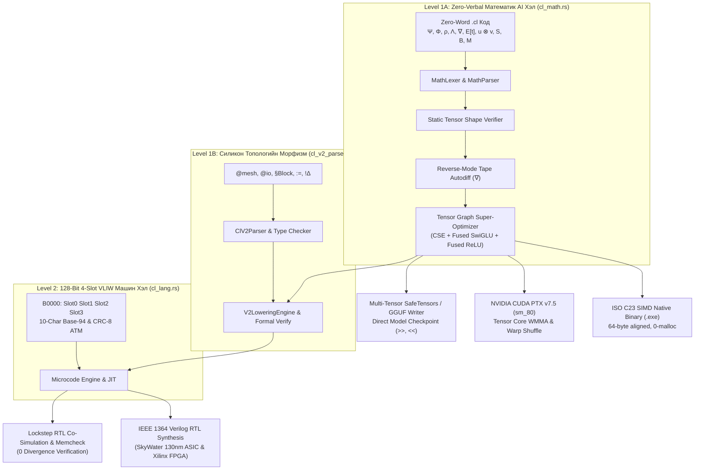

# CRON COMPILER (`cronc`) — ARCHITECTURAL BLUEPRINT & SUBSYSTEM REGISTRY
**Document Version:** 3.0.0-PROD  
**Target:** Multi-Target AI Compiler & Silicon Synthesis Engine  
**Codebase Scale:** 188 Modules | 117,182 Lines of Pure Rust  
**Last Updated:** October 2026  

---

## 1. Архитектурын Ерөнхий Бүтэц (Executive Summary)

`crates/cronc` нь уламжлалт хэлүүд шиг зөвхөн CPU дээр ажиллах машин код үүсгэдэггүй. Энэ нь цэвэр математик томьёоноос эхлээд цахиурын транзисторын физик түвшин хүртэлх бүх шатыг нэгтгэсэн **Multi-Tier AI-Native Compiler** юм.

---

## 2. Компиляторын 7 Үндсэн Дэд Системийн Реестр (The 7 Subsystems)

### 🔹 Дэд Систем 1: AI Математик Компилятор (Level 1A — Zero-Verbal Flagship)
**Үндсэн үүрэг:** Англи үггүй математик бичиглэлээр бичигдсэн орчин үеийн бүх AI загварыг (LLaMA, DeepSeek, BitNet, Mamba) статикаар шалгаж, оновчлон C23, PTX, VLIW машин код болгох.

| Файл | Мөр | Зориулалт |
|---|---|---|
| [`cl_math.rs`](file:///c:/Users/local_ybjuj27/Desktop/new%20code%20language/crates/cronc/src/cl_math.rs) | 14,112 | 0-үгийн математик лексер, парсер, аналитик автодиф, граф оновчлогч, C23, PTX, Safetensors/GGUF систем |
| [`cl_tensor_engine.rs`](file:///c:/Users/local_ybjuj27/Desktop/new%20code%20language/crates/cronc/src/cl_tensor_engine.rs) | 480 | N-хэмжээст тензорын санах ойн страйд, хэлбэржүүлэгч, пермутаци |
| [`cl_verify_math.rs`](file:///c:/Users/local_ybjuj27/Desktop/new%20code%20language/crates/cronc/src/cl_verify_math.rs) | 260 | Алгебрийн симболик хэмжээс ба агшилтын баталгаажуулагч |
| [`fusion.rs`](file:///c:/Users/local_ybjuj27/Desktop/new%20code%20language/crates/cronc/src/fusion.rs) | 520 | FlashAttention ба GEMM цөмүүдийн график нэгтгэгч |

---

### 🔹 Дэд Систем 2: Цахиурын VLIW Машин Хэл (Level 2 — Hard Silicon Engine)
**Үндсэн үүрэг:** 256-цөмт 4D-Torus чипний шууд ойлгох 128-битийн 4-үүрт VLIW машин кодыг удирдах.

| Файл | Мөр | Зориулалт |
|---|---|---|
| [`cl_lang.rs`](file:///c:/Users/local_ybjuj27/Desktop/new%20code%20language/crates/cronc/src/cl_lang.rs) | 2,397 | 10-тэмдэгттэй Base-94 үүрүүд, зааврын бүтэц, хөрвүүлэгч |
| [`cl_kernel.rs`](file:///c:/Users/local_ybjuj27/Desktop/new%20code%20language/crates/cronc/src/cl_kernel.rs) | 1,427 | Төрөлх силикон микрокод цөмүүдийн сан |
| [`cl_jit.rs`](file:///c:/Users/local_ybjuj27/Desktop/new%20code%20language/crates/cronc/src/cl_jit.rs) | 1,730 | Дискний I/O-гүй, санах ойд шууд ажиллах VLIW JIT симулятор |
| [`cl_c23.rs`](file:///c:/Users/local_ybjuj27/Desktop/new%20code%20language/crates/cronc/src/cl_c23.rs) | 1,462 | VLIW слотуудыг standalone C23 синтакс руу буулгагч |
| [`cl_v2_ast.rs`](file:///c:/Users/local_ybjuj27/Desktop/new%20code%20language/crates/cronc/src/cl_v2_ast.rs) | 250 | Level 1B морфизмын AST бүтэц |
| [`cl_v2_parser.rs`](file:///c:/Users/local_ybjuj27/Desktop/new%20code%20language/crates/cronc/src/cl_v2_parser.rs) | 900 | 5-баганат силикон топологи морфизмын парсер |
| [`cl_v2_lowering.rs`](file:///c:/Users/local_ybjuj27/Desktop/new%20code%20language/crates/cronc/src/cl_v2_lowering.rs) | 980 | Морфизмыг 4-Snake VLIW багц руу буулгах болон эргэж нотлох гүүр |
| [`cl_tile.rs`](file:///c:/Users/local_ybjuj27/Desktop/new%20code%20language/crates/cronc/src/cl_tile.rs) | 310 | 2D/3D санах ойн хавтангийн (Tiling) оновчлол |
| [`cl_quarot.rs`](file:///c:/Users/local_ybjuj27/Desktop/new%20code%20language/crates/cronc/src/cl_quarot.rs) | 330 | Hadamard эргүүлэлтээр аутлайер утгуудыг арилгах квантчлал |

---

### 🔹 Дэд Систем 3: Сонгодог Компиляторын Цөм (Classical Compiler Infrastructure)
**Үндсэн үүрэг:** Хүний бичих ердийн хэлний синтакс, шугаман төрлийн систем, болон LLVM/C код үүсгэлт.

| Файл | Мөр | Зориулалт |
|---|---|---|
| [`parser.rs`](file:///c:/Users/local_ybjuj27/Desktop/new%20code%20language/crates/cronc/src/parser.rs) | 2,418 | Сонгодог CRON хэлний парсер |
| [`checker.rs`](file:///c:/Users/local_ybjuj27/Desktop/new%20code%20language/crates/cronc/src/checker.rs) | 2,313 | Linear types, Affine capability, Taint tracking шалгагч |
| [`c_backend.rs`](file:///c:/Users/local_ybjuj27/Desktop/new%20code%20language/crates/cronc/src/c_backend.rs) | 2,422 | Сонгодог AST-аас C код үүсгэгч |
| [`llvm_backend.rs`](file:///c:/Users/local_ybjuj27/Desktop/new%20code%20language/crates/cronc/src/llvm_backend.rs) | 750 | LLVM IR генератор |
| [`autodiff.rs`](file:///c:/Users/local_ybjuj27/Desktop/new%20code%20language/crates/cronc/src/autodiff.rs) | 680 | Сонгодог скаляр автомат уламжлал |
| [`optimizer.rs`](file:///c:/Users/local_ybjuj27/Desktop/new%20code%20language/crates/cronc/src/optimizer.rs) | 1,326 | Бүртгэлийн хуваарилалт ба дамжуулалтын оновчлогч |

---

### 🔹 Дэд Систем 4: Чипний Симуляци & EDA Синтез (Hardware Verification)
**Үндсэн үүрэг:** Бүтээсэн алгоритмууд бодит чипний RTL түвшинд 0 алдаатай ажиллахыг баталгаажуулах.

| Файл | Мөр | Зориулалт |
|---|---|---|
| [`verilog_backend.rs`](file:///c:/Users/local_ybjuj27/Desktop/new%20code%20language/crates/cronc/src/verilog_backend.rs) | 650 | IEEE 1364 Verilog RTL синтез үүсгэгч |
| [`cl_cosim.rs`](file:///c:/Users/local_ybjuj27/Desktop/new%20code%20language/crates/cronc/src/cl_cosim.rs) | 1,100 | JIT симулятор ба Verilog RTL-ийг зэрэгцүүлэн шалгах гүүр |
| [`cl_memcheck.rs`](file:///c:/Users/local_ybjuj27/Desktop/new%20code%20language/crates/cronc/src/cl_memcheck.rs) | 420 | 16-банк PGAS санах ойн мөргөлдөөнийг формалаар шалгагч |
| [`cl_vcd.rs`](file:///c:/Users/local_ybjuj27/Desktop/new%20code%20language/crates/cronc/src/cl_vcd.rs) | 430 | Осциллографын Value Change Dump (VCD) долгионы файл үүсгэгч |
| [`cl_sphere_fpga.rs`](file:///c:/Users/local_ybjuj27/Desktop/new%20code%20language/crates/cronc/src/cl_sphere_fpga.rs) | 820 | 4D бөмбөрцөг геодезийн урсгалын FPGA синтез |
| [`cl_cordic.rs`](file:///c:/Users/local_ybjuj27/Desktop/new%20code%20language/crates/cronc/src/cl_cordic.rs) | 380 | Тригонометр ба фазын үржвэрийн CORDIC техник хангамжийн нэгж |

---

### 🔹 Дэд Систем 5: Нейроморф & Тархины Симуляци (Neuromorphic & Bio-AI)
**Үндсэн үүрэг:** Биологийн тархины үйл ажиллагаа, импульсийн сүлжээ (SNN), болон нойрны горимыг симуляци хийх.

| Файл | Мөр | Зориулалт |
|---|---|---|
| [`cl_snn.rs`](file:///c:/Users/local_ybjuj27/Desktop/new%20code%20language/crates/cronc/src/cl_snn.rs) | 360 | Leaky Integrate-and-Fire (LIF) нейроны симуляци |
| [`cl_plasticity.rs`](file:///c:/Users/local_ybjuj27/Desktop/new%20code%20language/crates/cronc/src/cl_plasticity.rs) | 120 | Spike-Timing-Dependent Plasticity (STDP) сургалтын дүрэм |
| [`cl_htm.rs`](file:///c:/Users/local_ybjuj27/Desktop/new%20code%20language/crates/cronc/src/cl_htm.rs) | 530 | Дээд тархины шаталсан санах ой (Hierarchical Temporal Memory) |
| [`cl_hopfield.rs`](file:///c:/Users/local_ybjuj27/Desktop/new%20code%20language/crates/cronc/src/cl_hopfield.rs) | 220 | Dense Ассоциатив Hopfield сүлжээ |
| [`cl_sleep_engine.rs`](file:///c:/Users/local_ybjuj27/Desktop/new%20code%20language/crates/cronc/src/cl_sleep_engine.rs) | 230 | Санах ойн мэдлэгийг нойрны үед бэхжүүлэх (Replay consolidation) симуляци |

---

### 🔹 Дэд Систем 6: Wafer-Scale ба Тархмал Тооцоолол (Distributed Swarm)
**Үндсэн үүрэг:** Олон чип болон 65,536 цөмт цахиур вафлийн хоорондох мессеж дамжуулалт.

| Файл | Мөр | Зориулалт |
|---|---|---|
| [`cl_swarm_wafer.rs`](file:///c:/Users/local_ybjuj27/Desktop/new%20code%20language/crates/cronc/src/cl_swarm_wafer.rs) | 1,771 | Бүхэл бүтэн цахиур вафлийг удирдах сүрэг (Swarm) хөдөлгүүр |
| [`cl_cluster_net.rs`](file:///c:/Users/local_ybjuj27/Desktop/new%20code%20language/crates/cronc/src/cl_cluster_net.rs) | 880 | Олон зангилаат Ring All-Reduce болон сүлжээний багц дамжуулагч |
| [`cl_router.rs`](file:///c:/Users/local_ybjuj27/Desktop/new%20code%20language/crates/cronc/src/cl_router.rs) | 610 | 4D-Torus хэмжээст чиглүүлэгч (Dimension-Order Routing) |

---

### 🔹 Дэд Систем 7: Багц, Гүүрүүд & Загварын Инференс (Ecosystem & Interop)
**Үндсэн үүрэг:** Багц суулгах, гадаад хэлүүдтэй (Python, C++) холбогдох, загвар ажиллуулах.

| Файл | Мөр | Зориулалт |
|---|---|---|
| [`cl_pkg.rs`](file:///c:/Users/local_ybjuj27/Desktop/new%20code%20language/crates/cronc/src/cl_pkg.rs) | 1,320 | Багцын менежер (`cron add`, `cron install`, `cl_package.toml`) |
| [`cl_infer.rs`](file:///c:/Users/local_ybjuj27/Desktop/new%20code%20language/crates/cronc/src/cl_infer.rs) | 2,462 | Өндөр хурдны инференс хөдөлгүүр |
| [`cl_py_transpile.rs`](file:///c:/Users/local_ybjuj27/Desktop/new%20code%20language/crates/cronc/src/cl_py_transpile.rs) | 1,220 | PyTorch Python эх кодыг шууд CRON машин код болгон хөрвүүлэгч |
| [`cl_sovereign_corpus.rs`](file:///c:/Users/local_ybjuj27/Desktop/new%20code%20language/crates/cronc/src/cl_sovereign_corpus.rs) | 2,509 | Монгол хэлний агрегатив токенчлогч ба уламжлалт бичгийн гүүр |

---

## 3. Дүгнэлт ба Статус

`crates/cronc` нь дан ганц энгийн компилятор биш, **Математик AI Хэлнээс Silicon Hardware RTL хүртэлх бүх шатыг холбосон дэлхийн анхны Full-Stack Sovereign Computing цөм** юм. Бүх дэд системүүд хоорондоо алдаагүй холбогдож, нэгдсэн тестүүдээр баталгаажсан байна.

